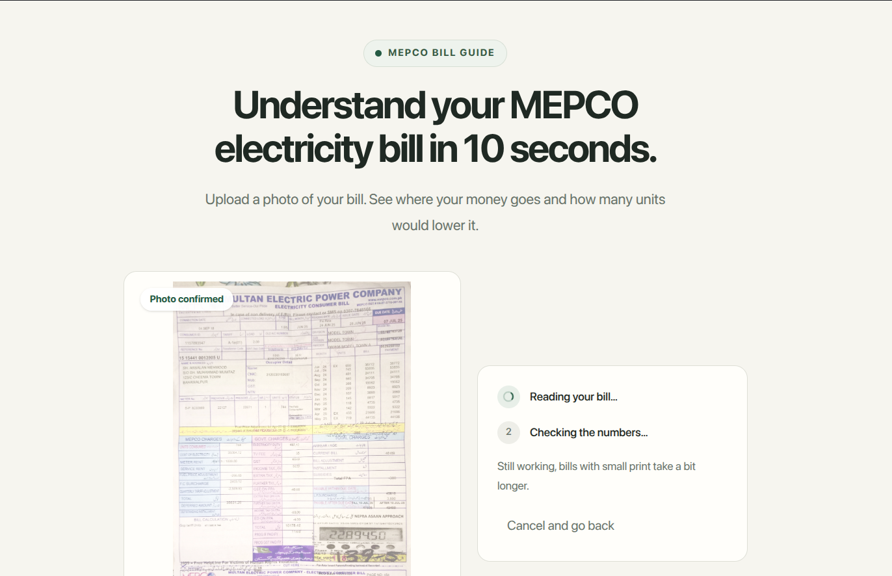

# Bijli Bill Decoder

<p align="center">
  
</p>

Bijli Bill Decoder is a small hackathon project for Pakistani households who find electricity bills hard to understand. MEPCO bills can combine energy charges, taxes, adjustments, arrears, and tariff details; the project aims to make those figures easier to check and explain.

The first version is scoped to **MEPCO residential bills**. A person selects a bill photo, reviews the extracted fields beside the photo, corrects mistakes, and checks whether the included line items add up to the printed payable total. Reconciliation is local arithmetic; it is not an AI estimate.

Built for: [Learn With Ai: Basics](https://learn-ai-basics.devpost.com/)

## Current proof-of-concept status

- Bill photos can be sent to Cloudflare Workers AI for field extraction after the user confirms the preview.
- The extracted fields are validated with Zod and shown for user review and editing.
- The line-item sum is checked in the app; a mismatch is flagged for correction.
- **Tariff calculations are intentionally unavailable** until the active demo bill's MEPCO residential tariff code and a dated tariff table are verified against a published source. The app must not guess a tariff.
- A redacted sample bill has not yet been added to the repository; the “Try a sample bill” entry point is a placeholder until then.

The reader can misread small print or amounts. Always compare the fields with the bill photo. A mismatch must be resolved or explicitly treated as unverified; it is not evidence that the bill itself is wrong.

## How the project was planned

The project was developed using the Build With AI Basics skill pack in a deliberate sequence:

1. **`1-start`** captured the learner's experience, goals, and project context before coding.
2. **`2-scope`** shaped the idea into a focused MEPCO residential bill-reading proof of concept.
3. **`3-prd`** defined the user journey, confirmation and review steps, failure states, privacy expectations, and what was out of scope.
4. **`4-spec`** chose the implementation architecture: React Router Framework Mode, TypeScript, Tailwind CSS, ShadCN-style UI components, and a server-side AI call.
5. **`5-build`** organized implementation into incremental steps.

This planning sequence helped turn an idea that began in the learner's head into a bounded project before implementation.

## How bill reading works

- The app uses **React Router Framework Mode**. The `/analyze` route action calls a server-only bill-reading service; Cloudflare credentials stay on the server.
- The model is Cloudflare Workers AI **`@cf/meta/llama-3.2-11b-vision-instruct`**, which reads the confirmed image and returns proposed bill fields.
- Zod validates the model response. The model does not calculate the tariff or decide whether the bill reconciles.
- The app performs the rupee/paisa line-item sum locally and lets the user edit extracted values.
- The photo and extracted bill values are not saved to a database by this proof of concept. The confirmed photo is transmitted to Cloudflare for inference.

## Requirements

- Node.js compatible with the installed React Router/Vite versions
- npm
- A Cloudflare account with Workers AI available
- A Cloudflare API token with **Account → Workers AI → Read** permission

Cloudflare's Workers AI free allocation and model availability can change. Check the current [Workers AI pricing and limits](https://developers.cloudflare.com/workers-ai/platform/pricing/) before relying on a particular quota.

## Configure Cloudflare Workers AI

### 1. Create `.env`

From the repository root, copy the example:

```bash
cp .env.example .env
```

Set the values in `.env` (keep the token private):

```dotenv
NODE_ENV=development
VITE_ENV=development
CLOUDFLARE_ACCOUNT_ID=
CLOUDFLARE_API_TOKEN=
```

Do not commit `.env` or paste the token into source code. `.env` is ignored by Git; `.env.example` is safe to commit because it contains no credentials.

### 2. Get the account ID and API token

1. Sign in to the [Cloudflare dashboard](https://dash.cloudflare.com/) and select the account you will use.
2. Open **Workers & Pages → Workers AI** and select **Use REST API**.
3. Copy the displayed **Account ID** into `CLOUDFLARE_ACCOUNT_ID`.
4. Select **Create a Workers AI API Token**, create and copy the token, and put its value in `CLOUDFLARE_API_TOKEN`. Use the Workers AI API token, not your Global API Key.
5. Keep the account ID and token from the same Cloudflare account. Cloudflare's [REST API setup guide](https://developers.cloudflare.com/workers-ai/get-started/rest-api/) has current dashboard steps.

### 3. Accept the model terms once

Before the first inference, Meta's license and acceptable-use terms for Llama 3.2 Vision must be accepted for the account. From a Bash terminal in the project root, run:

```bash
set -a
source .env
set +a
curl -X POST \
  "https://api.cloudflare.com/client/v4/accounts/${CLOUDFLARE_ACCOUNT_ID}/ai/run/@cf/meta/llama-3.2-11b-vision-instruct" \
  -H "Authorization: Bearer ${CLOUDFLARE_API_TOKEN}" \
  -H "Content-Type: application/json" \
  --data '{"prompt":"agree"}'
```

This is a one-time model-terms request; it does not include a bill image. Cloudflare documents this step on the [Llama 3.2 11B Vision model page](https://developers.cloudflare.com/workers-ai/models/llama-3.2-11b-vision-instruct/). Restart the development server after changing `.env`.

## Run locally

```bash
npm install
npm run dev
```

Open the local URL printed by the development server (normally `http://localhost:5173`).

## Useful commands

```bash
npm run typecheck
npm run build
npm run start
```

## Technology

- React Router Framework Mode and TypeScript
- React, Tailwind CSS, and ShadCN-style UI components
- Zod for validating extracted fields
- Cloudflare Workers AI for vision-based bill field extraction
- Integer paisa for local reconciliation arithmetic

## License

This project is licensed under the MIT License. See [`LICENSE`](./LICENSE).
